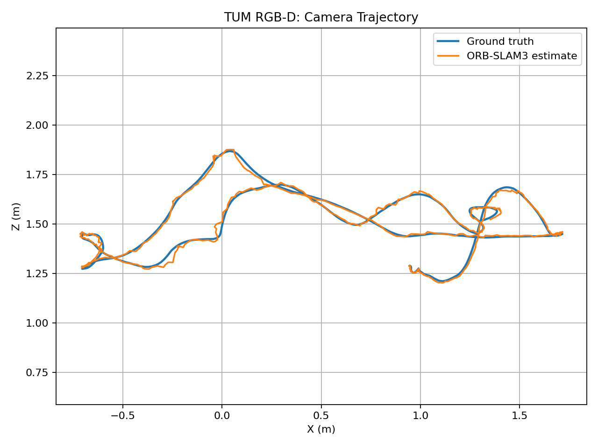
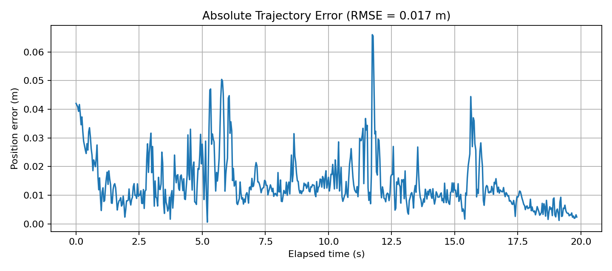

# Visual SLAM and Drone Navigation

An ongoing computer vision and robotics project exploring Simultaneous Localization and Mapping (SLAM), trajectory evaluation, and the foundations of autonomous drone navigation.

The current milestone is a working **ORB-SLAM3 RGB-D pipeline** evaluated on the TUM RGB-D benchmark. Future phases will extend the project to visual-inertial SLAM and drone simulation.

## Results

**Dataset:** TUM RGB-D — `freiburg1_desk`
**SLAM system:** ORB-SLAM3, RGB-D mode
**Evaluation:** Absolute Trajectory Error (ATE), after rigid trajectory alignment

| Metric | Result |
|---|---:|
| Estimated camera poses | 596 |
| Matched ground-truth poses | 596 / 596 |
| ATE RMSE | 0.017092 m |
| ATE median | 0.011763 m |
| ATE mean | 0.014253 m |
| ATE maximum | 0.066066 m |
| Mean timestamp difference | 0.00173 s |

The trajectory evaluation was independently cross-checked using the `evo` trajectory evaluation toolkit. Both implementations reported an ATE RMSE of approximately **1.71 cm**.

These results are specific to this recorded RGB-D sequence and the stated alignment procedure. They do not represent real-world drone navigation accuracy.

## Trajectory Visualizations

### Estimated Trajectory vs. Ground Truth



### Position Error Over Time



## Project Overview

The pipeline processes recorded RGB and depth images, estimates camera poses, and compares the estimated trajectory against ground-truth camera poses.

### Current Pipeline

1. Prepare the RGB-D dataset.
2. Associate RGB and depth frames using timestamps.
3. Run ORB-SLAM3 in RGB-D mode.
4. Export estimated camera and keyframe trajectories.
5. Match estimated poses to ground-truth timestamps.
6. Align trajectories using rigid rotation and translation.
7. Calculate Absolute Trajectory Error (ATE).
8. Visualize the trajectory and position error.
9. Cross-check the evaluation using `evo`.

## Technology Stack

- **SLAM:** ORB-SLAM3
- **Programming:** C++, Python 3
- **Computer vision:** OpenCV
- **Numerical computing:** Eigen, NumPy
- **Visualization:** Pangolin, Matplotlib
- **Environment:** Ubuntu 22.04
- **Robotics:** ROS 2 Humble
- **Planned simulation:** PX4 and Gazebo

## Dataset

**TUM RGB-D — freiburg1_desk**

Dataset: https://cvg.cit.tum.de/rgbd/dataset/freiburg1

The sequence contains RGB images, depth images, timestamps, and ground-truth camera poses.

The current experiment evaluates offline RGB-D SLAM. Visual-inertial drone navigation has not yet been implemented.

## Repository Structure

```text
drone-slam/
├── README.md
├── scripts/
│   ├── associate.py
│   └── evaluate_trajectory.py
└── results/
    ├── CameraTrajectory.txt
    ├── KeyFrameTrajectory.txt
    ├── aligned_trajectory_comparison.txt
    ├── trajectory_comparison.png
    ├── trajectory_error.png
    └── baseline/
```

The dataset, virtual environment, and ORB-SLAM3 source/build files are maintained separately from this repository.

## Reproducing the Experiment

### 1. Set up Python

```bash
python3 -m venv .venv
source .venv/bin/activate
python -m pip install "numpy==1.26.4" "matplotlib==3.8.4" pandas pyyaml opencv-python
```

### 2. Prepare the dataset

Download the `freiburg1_desk` sequence from the official TUM RGB-D dataset page and extract it locally.

Build ORB-SLAM3 and its dependencies using the official instructions:

https://github.com/UZ-SLAMLab/ORB_SLAM3

### 3. Run the pipeline

Generate RGB-depth associations using the repository's association script:

```bash
python scripts/associate.py
```

Run the ORB-SLAM3 RGB-D example using the vocabulary, configuration, dataset, and association file paths appropriate to your local installation.

Evaluate the saved trajectory:

```bash
python scripts/evaluate_trajectory.py
```

The evaluation scripts and ORB-SLAM3 build expect the relevant dataset and software dependencies to be available locally.

## Roadmap

- [x] Set up the Python environment.
- [x] Build ORB-SLAM3 and its dependencies.
- [x] Run an RGB-D benchmark sequence.
- [x] Export camera and keyframe trajectories.
- [x] Generate trajectory comparison and error plots.
- [x] Preserve baseline outputs.
- [x] Cross-check ATE evaluation using `evo`.
- [ ] Evaluate additional benchmark sequences.
- [ ] Run visual-inertial SLAM on a drone-specific dataset.
- [ ] Integrate PX4 and Gazebo simulation.
- [ ] Compare simulated drone trajectories with ground truth.
- [ ] Explore onboard deployment and real-time constraints.

## Future Work

The long-term goal is to develop a drone navigation pipeline combining camera and IMU measurements, visual-inertial localization, mapping, and simulation-based evaluation.

## Attribution

ORB-SLAM3, the TUM RGB-D dataset, and other dependencies retain their respective licenses and attribution requirements. Refer to their official sources before redistributing code or data.
