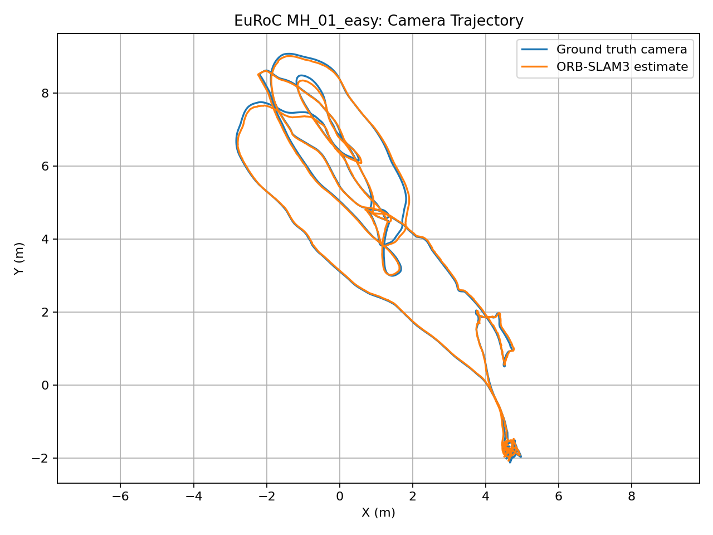
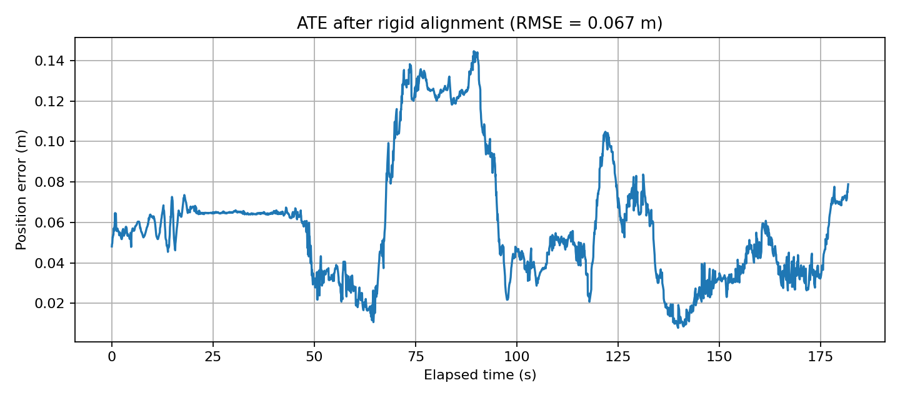

# Visual SLAM and Drone Navigation

An ongoing computer vision and robotics project exploring Simultaneous Localization and Mapping (SLAM), visual-inertial estimation, trajectory evaluation, and the foundations of autonomous drone navigation.

This project currently includes two offline benchmark experiments:
- ORB-SLAM3 RGB-D on the TUM RGB-D `freiburg1_desk` sequence.
- ORB-SLAM3 Stereo-Inertial on the EuRoC MAV `MH_01_easy` sequence.

**Scope:** These are recorded-dataset experiments. Integration with PX4/Gazebo, live drone navigation, and onboard deployment remain future work.

## Experiments and Results

### 1. TUM RGB-D — freiburg1_desk

| Metric | Result |
|---|---:|
| Estimated camera poses | 596 |
| Matched ground-truth poses | 596 / 596 |
| ATE RMSE | 0.017092 m |
| ATE median | 0.011763 m |
| ATE mean | 0.014253 m |
| ATE maximum | 0.066066 m |

The trajectory evaluation was independently cross-checked using the `evo` trajectory evaluation toolkit. Both implementations reported an ATE RMSE of approximately **1.71 cm**.

These results apply to this recorded RGB-D sequence and the stated alignment procedure; they do not represent real-world drone navigation accuracy.

### 2. EuRoC MAV — MH_01_easy

**Configuration:** ORB-SLAM3 Stereo-Inertial
**Dataset:** EuRoC MAV `MH_01_easy`
**Evaluation:** Preliminary Absolute Trajectory Error (ATE), following rigid trajectory alignment.

| Metric | Preliminary result |
|---|---:|
| Estimated poses | 3,593 |
| Matched poses within 10 ms | 3,571 |
| Match coverage | 99.39% |
| ATE RMSE | 0.0660 m |
| ATE median | 0.0547 m |
| ATE maximum | 0.1458 m |

The preliminary evaluation script matches estimated and ground-truth timestamps, applies the configured camera/body extrinsic transform, aligns the trajectories, and computes position errors.

**Important limitation:** The run logged an initialization reset before recovering. The EuRoC evaluation and coordinate-frame conventions still require validation, so these metrics should not be treated as definitive accuracy claims. High timestamp-match coverage alone does not establish continuous tracking.

## Visualizations

### TUM RGB-D trajectory comparison


### TUM RGB-D position error


### EuRoC trajectory comparison



### EuRoC position error



The plots are generated from recorded benchmark trajectories. The live ORB-SLAM3 viewer is used to inspect feature tracking and the reconstructed sparse map during execution.

## Pipeline

1. Prepare the benchmark dataset and its timestamps.
2. Configure ORB-SLAM3 for the selected sensor mode.
3. Run the recorded RGB-D or stereo-inertial sequence.
4. Export estimated camera and keyframe trajectories.
5. Match estimates to ground-truth timestamps.
6. Align estimated and reference trajectories.
7. Calculate Absolute Trajectory Error (ATE).
8. Generate trajectory comparison and position-error plots.
9. Cross-check the RGB-D evaluation with `evo`.

## Technology Stack

- **SLAM:** ORB-SLAM3
- **Languages:** C++, Python
- **Computer vision:** OpenCV
- **Numerical computing:** Eigen, NumPy
- **Visualization:** Pangolin, Matplotlib
- **Environment:** Ubuntu 22.04
- **Robotics:** ROS 2 Humble environment available for future integration
- **Planned simulation:** PX4 and Gazebo

## Repository Structure

```text
drone-slam/
├── README.md
├── scripts/
│   ├── associate.py
│   ├── evaluate_trajectory.py
│   └── evaluate_euroc.py
└── results/
    ├── CameraTrajectory.txt
    ├── KeyFrameTrajectory.txt
    ├── trajectory_comparison.png
    ├── trajectory_error.png
    ├── baseline/
    └── euroc_mh01/
        ├── CameraTrajectory.txt
        ├── KeyFrameTrajectory.txt
        ├── aligned_trajectory.txt
        ├── trajectory_comparison.png
        └── trajectory_error.png
```

The EuRoC dataset, large dataset archives, Python virtual environment, and ORB-SLAM3 source/build files are kept outside this repository.

## Reproducing the Experiments

### 1. Python environment

```bash
python3 -m venv .venv
source .venv/bin/activate
python -m pip install "numpy==1.26.4" "matplotlib==3.8.4" pandas pyyaml opencv-python
```

### 2. Build ORB-SLAM3

Follow the upstream build instructions and install its required dependencies:

https://github.com/UZ-SLAMLab/ORB_SLAM3

### 3. TUM RGB-D experiment

Download and extract the `freiburg1_desk` sequence from:

https://cvg.cit.tum.de/rgbd/dataset/freiburg1

Generate the required RGB-depth associations:

```bash
python scripts/associate.py
```

Run the ORB-SLAM3 RGB-D example using your local vocabulary, configuration, dataset, and association paths. Then evaluate the exported trajectory:

```bash
python scripts/evaluate_trajectory.py
```

### 4. EuRoC stereo-inertial experiment

Download the EuRoC MAV dataset and extract `MH_01_easy`. From the ORB-SLAM3 source directory, run:

```bash
cd ~/ORB_SLAM3

./Examples/Stereo-Inertial/stereo_inertial_euroc \
  Vocabulary/ORBvoc.txt \
  Examples/Stereo-Inertial/EuRoC.yaml \
  ~/datasets/euroc/MH_01_easy \
  Examples/Stereo-Inertial/EuRoC_TimeStamps/MH01.txt
```

Copy the exported trajectory files into this repository's `results/euroc_mh01/` directory, then run the evaluation script from the repository root:

```bash
cd ~/drone-slam
source .venv/bin/activate
python scripts/evaluate_euroc.py
```

Dataset paths may need to be adjusted for your local installation. Download the datasets separately; do not commit dataset archives to Git.

## Roadmap

- [x] Build ORB-SLAM3 and its dependencies.
- [x] Run the TUM RGB-D benchmark.
- [x] Export trajectories and generate evaluation plots.
- [x] Cross-check RGB-D ATE with `evo`.
- [x] Run ORB-SLAM3 Stereo-Inertial on EuRoC `MH_01_easy`.
- [x] Export EuRoC trajectories and generate preliminary evaluation plots.
- [ ] Validate EuRoC coordinate-frame and extrinsic-transform conventions.
- [ ] Investigate initialization resets and tracking continuity.
- [ ] Evaluate additional benchmark sequences.
- [ ] Integrate SLAM output with PX4/Gazebo simulation.
- [ ] Compare simulated drone trajectories against ground truth.
- [ ] Explore onboard deployment and real-time constraints.

## Future Work

The long-term goal is to develop a drone navigation pipeline combining camera and IMU measurements, visual-inertial localization, mapping, and simulation-based evaluation. Future work will focus on evaluation reliability, navigation-stack integration, and deployment constraints.

## Attribution

ORB-SLAM3, the TUM RGB-D dataset, the EuRoC MAV dataset, and all other dependencies retain their respective licenses and attribution requirements. Refer to the upstream project and dataset documentation before redistributing their contents.
